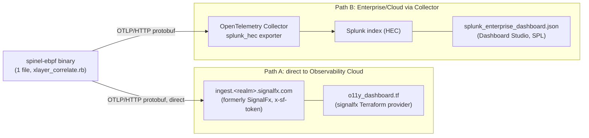

# Dashboard-as-code for Splunk (L2–L8 cross-layer correlation)

This collects the dashboard definitions (dashboard-as-code) for showing, across layers in Splunk,
**the single record in which L3/L4 + L7 + L8 live together** that spinel-ebpf's single binary emits over OTLP
(E274 /
E275), together with how they look and how to use them.

> **The honest premise**: this repo has **not verified a connection to a real Splunk or real rendering** (that needs an account /
> realm / token). What is here is "a reproducible definition that can (should) draw with these definitions" and
> "a doc of how it looks", not "proven to look clean in Splunk". Real rendering needs an account.
> What was verified is three points: (a) the JSON is valid, (b) the attribute / metric names it refers to **match keys that
> really exist** in spinel-ebpf (it charts no attribute that does not exist), and (c) the direct-send env procedure agrees with the existing
> ones (E264–E268).

## The two ingest paths and their files

Splunk has two paths for taking in OTLP, and a separate dashboard format is provided for each.



| Path | Destination | File used | Dashboard technology |
|---|---|---|---|
| **A: direct to Observability Cloud** | `ingest.<realm>.signalfx.com` (the other end of E264's `x-sf-token`) | `o11y_dashboard.tf` | SignalFx Terraform provider (`signalfx_dashboard` and others) + SignalFlow |
| **B: Enterprise/Cloud via Collector** | Collector → `splunk_hec` → Splunk index | `splunk_enterprise_dashboard.json` | Dashboard Studio JSON + SPL |

- Path A draws **metrics** (the quantiles / count of `http.server.request.duration`, `net.tcp.*`) with
  SignalFlow. Its selling point is direct sending (no Collector needed).
- Path B stores **traces/logs (spans)** in an index and runs stats over any field with SPL.
  It handles high-cardinality attributes (below) straightforwardly.

## The attributes / metrics referred to (all real keys)

The dashboards refer only to keys spinel-ebpf really emits (no chart of an attribute that does not exist).

| Layer | Key | Type | Source |
|---|---|---|---|
| metric | `http.server.request.duration` | Float64 explicit-bucket Histogram (unit=s) | E272 |
| L3 | `client.address` | string | E274 span |
| L4 | `server.address` / `server.port` | string / int | E274 span |
| L4 | `net.tcp.established` / `net.tcp.state_changes` | int (4-tuple keyed) | E274 span (our own) |
| L7 | `http.request.method` / `url.path` / `url.scheme` / `http.route` | string | E270/E272 |
| L7 | `http.response.status_code` | int | E272 |
| L7 | span duration (latency) | — | span |
| L8 | `tenant` | string (from X-Tenant or the route) | E274 |
| L8 | W3C `traceparent` inheritance (traceId / parentSpanId) | — | E270 |
| resource | `service.name` / `service.instance.id` / `telemetry.sdk.{name,language,version}` (+ `service.version`) | — | E272 |

The explicit bucket boundaries of `http.server.request.duration` are
`[0, 0.005, 0.01, 0.025, 0.05, 0.075, 0.1, 0.25, 0.5, 0.75, 1, 2.5, 5, 7.5, 10]` (seconds, E272).

## Where attributes belong: the design rule (honestly)

When OTLP flows into Splunk, **whether an attribute goes on the metrics side or the traces/logs side** is
decided by cardinality. Getting this wrong makes Observability Cloud's billing (the MTS count) and
metric cardinality explode.

| Cardinality | Examples | Where it goes | Why |
|---|---|---|---|
| **Low** | `http.route` / `http.request.method` / `http.response.status_code` | a **metrics** dimension | A finite set of values. The MTS count stays bounded, and it suits quantile / rate aggregation |
| **High** | `client.address` / `tenant` (many) / 4-tuple / `traceId` | the **traces / logs** side | As a metric dimension it explodes the MTS count and the bill. Keep it per span/log and search when needed |

- On path A (Observability Cloud), giving `http.server.request.duration` the dimensions `http.route` /
  `method` / `status` is reasonable. Avoid making `client.address` or a large number of
  `tenant` values a metric dimension; pick them up **on the trace side**.
- Path B (SPL) stores raw spans in the index, so even high cardinality can be handled by search
  (with a trade-off against retention / storage).

## The selling point of cross-layer correlation (the heart of this demo)

Traditional monitoring has a different correlation key per layer (NetFlow=4-tuple / APM=traceId / app logs=user_id),
so they cannot be joined afterwards. spinel-ebpf **puts L3/L4 + L7 + L8 together in 1 record (1 span)**,
so in Splunk it can **splitBy / filter on any axis without a cross join**.

Examples:
- "slow routes with `tenant=acme` and many `net.tcp.state_changes`" in **1 filter**.
  - Path A: the `xlayer_tcp` chart split by `tenant` / `http.route`, beside the duration chart.
  - Path B: the SPL of `ds_xlayer_table` puts `state_changes` /
    `established` / `avg_duration` / `requests` by `tenant` × `http.route` in 1 table (`splunk_enterprise_dashboard.json`).
- variables (dashboard filters) = `tenant`, `http.route`, provided in both formats.

This is not a reinvention of "cross-layer eBPF correlation itself" (= the domain of Cilium/Hubble). It shows
the form unique to spinel-ebpf: **1 record that lifts that correlation up to L8 (the app's tenant), sent directly to an existing SaaS, Splunk, and drawn there**
(the value proposition §L2–L8).

## Direct-send env (path A, following E264–E268)

Direct sending to Observability Cloud works with the existing direct-send enablers (no recompilation).
**The endpoint / realm below are examples; this repo does not connect to them**.

```sh
# An example of sending directly to Splunk Observability Cloud (SignalFx)
export OTEL_EXPORTER_OTLP_HEADERS="x-sf-token=$SPLUNK_ACCESS_TOKEN"   # E264: the auth header
export OTEL_EXPORTER_OTLP_COMPRESSION=gzip                            # E264: gzip compression

# HTTP direct (E264):  http://... (plain text) / https://... (E265-268, direct over mbedTLS)
./workload_self --instrument-otlp \
  https://ingest.us1.signalfx.com/v2/datapoint    # match <realm> and the path to the real endpoint

# For gRPC-over-TLS (E267): grpcs://ingest.<realm>.signalfx.com:443
```

- Passing `https://` / `grpcs://` makes build_binary detect the scheme and link mbedTLS automatically
  (E265–E268). TLS verification uses the system CA / `OTEL_EXPORTER_OTLP_CERTIFICATE` /
  `OTEL_EXPORTER_OTLP_INSECURE_SKIP_VERIFY`.
- Use the Splunk org's values for the real endpoint (`/v2/datapoint` and so on) and the realm. The above is only an example.

## Reading the access classification (`access_class`, E276)

E276's
`access_classifier.rb` **classifies the incoming traffic during an access surge on the spot, with XDP**,
and sends the per-class rates over OTLP as the `access_class` metric. It does not copy or mirror packets;
it counts directly at the kernel's receive hook.

| Key | Type | Values | Source |
|---|---|---|---|
| metric | `access_class` | Sum (monotonic counter = the source of a rate) | E276 |
| dimension | `proto` | `icmp` / `udp` / `tcp` / `other` | XDP `pkt_l4_proto` (E030) |
| dimension | `tcp_state` | `syn` / `established` | the SYN/ACK bits of XDP `pkt_tcp_flags` (E050) |

`tcp_state=syn` is **SYN set, no ACK = the start of a new connection**; `established` is an established session
(SYN-ACK/ACK/data/FIN/RST). Separating the two tells "**a SYN surge (a spike of new connections)**" apart from
"**growth in established traffic**" — the nature of an access surge can be read off 1 chart.

- Path A (Observability Cloud): the `access_class` chart (`signalfx_time_chart.access_class` in
  `o11y_dashboard.tf`) is a ColumnChart split by `proto` / `tcp_state`.
- Path B (Enterprise/SPL): the `viz_access_class` panel (`ds_access_class`'s `mstats sum(_value)
  ... BY proto tcp_state`). The metric index (e.g. `otel_metrics`) depends on the ingest settings.

**Cardinality discipline**: the dimensions of `access_class` are finite and fixed (proto × tcp_state = at most 8 kinds), so
they sit safely on metrics. **Do not make a high-cardinality dimension like the source (`src_ip`) a metrics dimension**
(the MTS count and the bill explode). To look per source, fold it into CIDR buckets / a top-N, or move it to the traces/logs side
(the same as "Where attributes belong" above). E276 handles only L3/L4's proto/tcp_state.

## Reading enforcement (blocking) (`action=pass|drop`, E277)

E277's `access_enforcer.rb` adds
**blocking on the spot (XDP_DROP)** to E276's classification. Its static policy is **XDP_DROP for ICMP, XDP_PASS for everything else (TCP/UDP/other)**,
and it puts an `action` (`pass`/`drop`) label on each series of the classification counts.
So **"how much is being dropped (drop) and how much passed (pass) right now" can be told apart in the `action` dimension of the same `access_class` metric**
(observation and enforcement in 1 binary).

| Key | Type | Values | Source |
|---|---|---|---|
| dimension | `action` | `pass` / `drop` | the XDP verdict (`XDP_DROP`=ICMP only / `XDP_PASS`=the rest, E032) |

- Path A (Observability Cloud): the `access_action` chart (`signalfx_time_chart.access_action` in
  `o11y_dashboard.tf`) splits `action=drop` and `action=pass` each by proto.
- Path B (Enterprise/SPL): the `viz_access_action` panel (`ds_access_action`'s `mstats sum(_value)
  ... BY action proto`).

**Why only ICMP is dropped (a safety reason, consistent with the Edoc)**: this enforcer's own direct OTLP sending goes out over **TCP**
(HTTP/gRPC). Dropping TCP would kill its own telemetry. Dropping UDP would take DNS and the like with it.
ICMP echo is harmless in the demo and fully reversible (a clean exit of the enforcer makes the destructor detach XDP,
as in E032), so the drop target is limited to ICMP. **v1 is a static policy** (a toggle that drops dynamically
past a threshold is a candidate extension that needs a userspace→kernel channel).

## Honest limits

- **Real rendering needs an account / token**. Not verified in this repo (only JSON valid + matching keys + a consistent env).
- **Our own attributes outside semconv** (`net.tcp.established` / `net.tcp.state_changes` / `tenant`) can be
  filtered / split, but **do not appear automatically in Splunk's pre-built (APM automatic) dashboards**.
  = They have to be **picked up explicitly by a hand-made dashboard** like this directory's.
- **L5/L6 (TLS decryption) is out of scope** (❌ in the value proposition too). The `https://`/`grpcs://` here is
  *direct sending over our own egress TLS*, not decryption of anyone else's traffic.
- **How certain the Terraform is**: the SignalFlow in `o11y_dashboard.tf` (`histogram(...).percentile(...)`),
  the variable block names, and the derivation of histogram MTS (`.count`/`.sum`) depend on the provider / ingest version.
  The comment at the top of the file already says "needs adjusting". `terraform validate` has not been run.
- **SPL field names**: how dotted attributes (`http.route` and so on) arrive at HEC ingest depends on
  the Collector's `splunk_hec` exporter settings. Adjust the `index` / `sourcetype` / `duration` field names
  to the environment (noted in the JSON's `_comment_*` and in the panel descriptions).

## Files

| File | Contents |
|---|---|
| `o11y_dashboard.tf` | Path A: the Splunk Observability Cloud (SignalFx) Terraform definition |
| `splunk_enterprise_dashboard.json` | Path B: the Splunk Enterprise/Cloud Dashboard Studio (SPL) definition (JSON valid) |
| `README.md` | this file |
